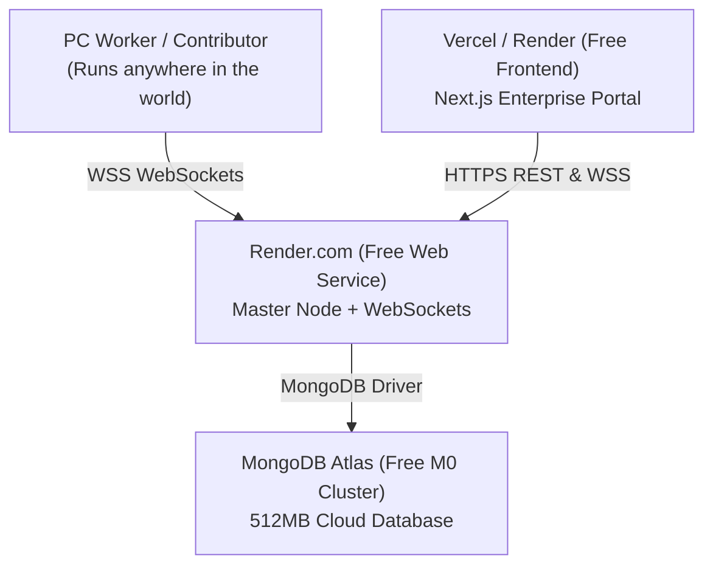

# 🚀 Deploying Vampire Cloud to the Internet for 100% Free

This guide walks you through deploying the complete **Vampire Cloud** platform (Master Orchestrator, Next.js Dashboard, and MongoDB Database) to the internet **completely free** with **zero credit card required**.

---

## Architecture Overview



---

## Step 1: Free Cloud Database (MongoDB Atlas)
*Takes ~2 minutes. 100% free forever, no credit card required.*

1. Go to [MongoDB Atlas](https://www.mongodb.com/cloud/atlas/register) and create a free account.
2. Under "Deploy a database", choose **M0 Free** (Shared Cluster).
3. Choose your nearest cloud region (e.g. AWS / us-east-1).
4. Create a database user:
   - Username: `vampire_admin`
   - Password: Choose a strong password (e.g., `VampireCloud2026!`)
5. In **Network Access**, click **Add IP Address** -> Select **Allow Access from Anywhere** (`0.0.0.0/0`) -> Click **Confirm**.
6. In **Database**, click **Connect** -> Choose **Drivers (Node.js)**:
   - Copy your connection string. It will look like:
     ```
     mongodb+srv://vampire_admin:<password>@cluster0.abcde.mongodb.net/vampire_cloud?retryWrites=true&w=majority
     ```
   - Replace `<password>` with your database user password and make sure `/vampire_cloud` is at the end.

---

## Step 2: Push Your Code to GitHub

1. If you haven't initialized git yet, initialize your repo:
   ```bash
   git init
   git add .
   git commit -m "feat: enterprise vampire cloud release"
   ```
2. Create a new repository on [GitHub](https://github.com/new) (can be Public or Private).
3. Push your repository:
   ```bash
   git remote add origin https://github.com/<your-username>/vampire-cloud.git
   git branch -M main
   git push -u origin main
   ```

---

## Step 3: Deploy Backend Master Node (Render.com)
*Render supports Node.js WebSockets natively on its Free Tier with free HTTPS/WSS.*

1. Go to [Render.com](https://render.com/) and sign up with your GitHub account.
2. Click **New +** -> Select **Web Service**.
3. Connect your `vampire-cloud` GitHub repository.
4. Fill in the service configuration:
   - **Name**: `vampire-cloud-master` (or any custom name)
   - **Root Directory**: `master`
   - **Environment**: `Node`
   - **Region**: Closest to your MongoDB Atlas region
   - **Build Command**: `npm ci --omit=dev`
   - **Start Command**: `node src/server.js`
   - **Plan Type**: **Free**
5. Scroll down to **Environment Variables** and add:
   - `PORT`: `10000`
   - `MONGODB_URI`: `mongodb+srv://vampire_admin:<password>@cluster0.abcde.mongodb.net/vampire_cloud?retryWrites=true&w=majority` (your connection string from Step 1)
   - `JWT_SECRET`: `vampire-secret-cloud-key-2026`
   - `TOTAL_TASKS`: `100`
   - `DIFFICULTY`: `5`
6. Click **Deploy Web Service**.
7. Once deployed, Render will provide your public URL (e.g. `https://vampire-cloud-master.onrender.com`).
   *Note: In Render free tier, WebSockets work seamlessly over `wss://vampire-cloud-master.onrender.com`.*

---

## Step 4: Deploy Next.js Dashboard (Vercel)
*Vercel provides edge hosting for Next.js completely free.*

1. Go to [Vercel.com](https://vercel.com/) and sign up with GitHub.
2. Click **Add New...** -> **Project**.
3. Import your `vampire-cloud` repository.
4. In Project Settings:
   - **Framework Preset**: Next.js
   - **Root Directory**: Click "Edit" and choose `dashboard`
5. Open **Environment Variables** and add:
   - `NEXT_PUBLIC_MASTER_API_URL`: `https://vampire-cloud-master.onrender.com` (your Render URL from Step 3)
   - `NEXT_PUBLIC_MASTER_WS_URL`: `wss://vampire-cloud-master.onrender.com/observer`
6. Click **Deploy**.
7. Vercel will build and deploy your frontend in ~45 seconds and give you a free production domain (e.g. `https://vampire-cloud.vercel.app`).

---

## Step 5: Test & Verify Your Deployed Grid

1. Open your Vercel URL in your browser (`https://vampire-cloud.vercel.app`).
2. Log in with your standard pre-seeded credentials:
   - **Root Administrator**: `admin@vampirecloud.network` / `admin123`
   - **Enterprise Client**: `company@apexquantum.ai` / `company123`
   - **Compute Contributor**: `user@vampirecloud.network` / `user123`
3. Click "Start Computing" inside the browser to verify real-time WebSockets over `wss://`.

---

## Step 6: Connect Any PC Worker Daemon from Home

Anyone can run the Python background worker from their home computer or VPS connecting to your cloud master:

```bash
# Clone the worker or run in your terminal:
python -m worker --master wss://vampire-cloud-master.onrender.com/worker --wallet 0xYourWalletAddress --name my-desktop-gpu
```

The worker will connect through encrypted WSS, receive workload tasks, compute SHA-256 nonces, and receive VAMP reward payouts directly to your cloud MongoDB ledger!
