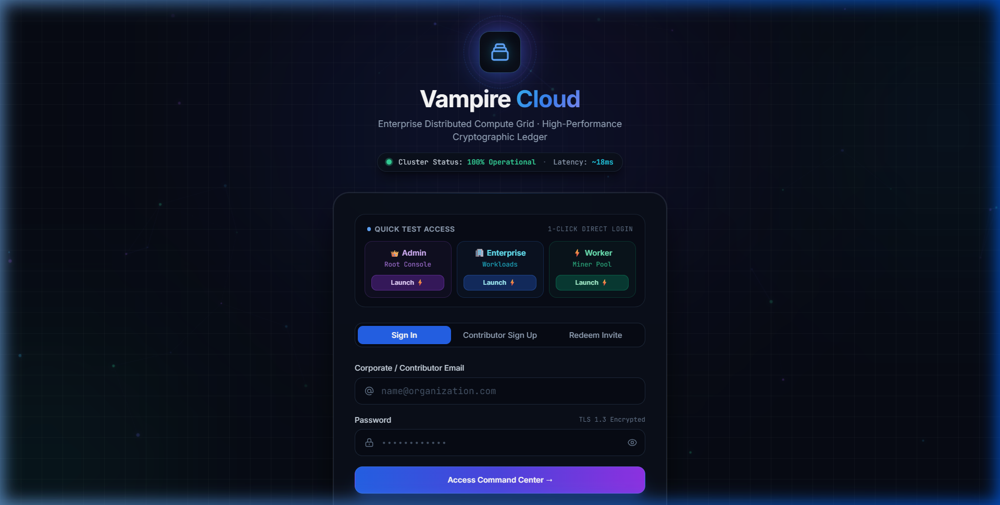
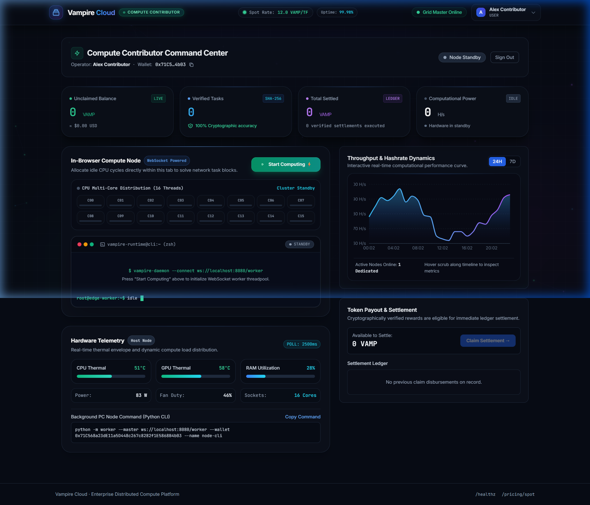
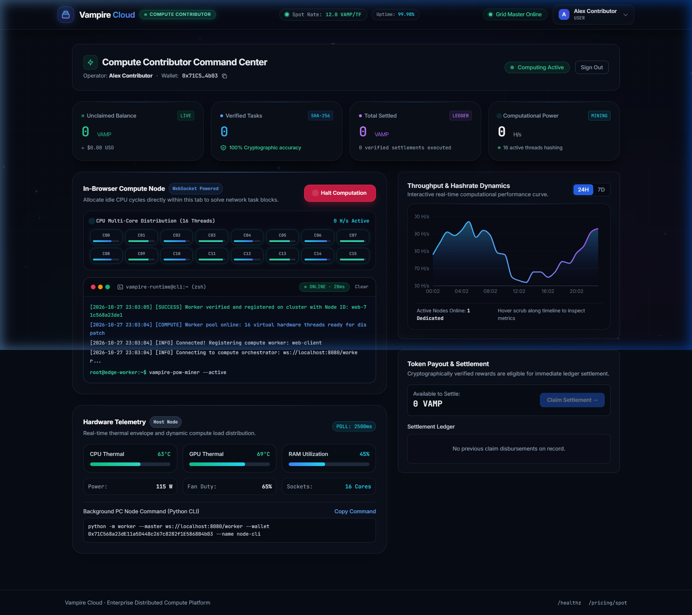
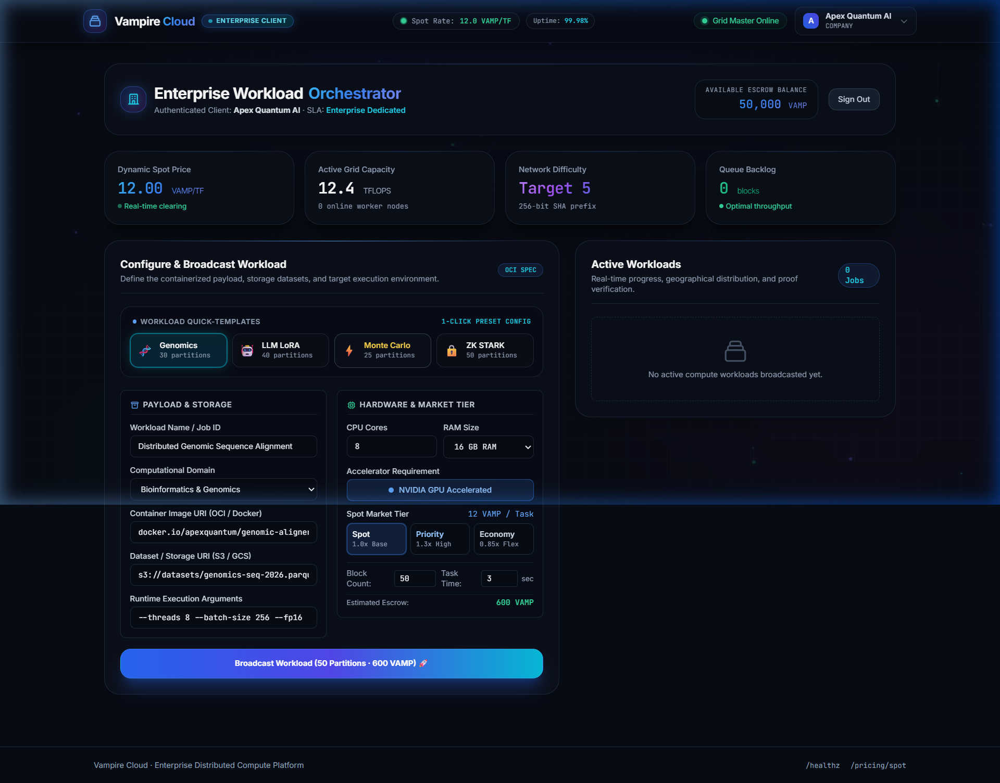
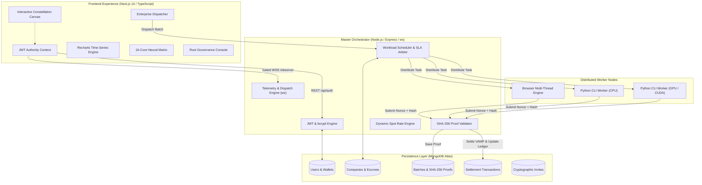

# <div align="center">🧛 VAMPIRE CLOUD</div>
### <div align="center">⚡ Autonomous Cryptographic Compute Grid & Micro-Settled Spot Market ⚡</div>

<div align="center">


[](https://drive.google.com/file/d/11cKdRtHdirJBxJKJ0Q1gMTc60F4EWiEf/view?usp=sharing)

**Dismantling centralized hyperscaler monopolies by transforming underutilized global consumer and enterprise hardware into a verified, high-throughput compute mesh.**

[📹 Demo Video](https://drive.google.com/file/d/11cKdRtHdirJBxJKJ0Q1gMTc60F4EWiEf/view?usp=sharing) • [Live Architecture](#-system-architecture) • [Visual Showcase](#-visual-showcase--portal-tour) • [Implemented Features](#-feature-matrix-what-we-built) • [Future Roadmap](#-the-grand-roadmap-what-needs-to-be-implemented) • [Quick Start](#-quick-start)

</div>

---

## 🎬 Project Video Demonstration

> 📺 **Full Platform Walkthrough & Live Demo:**  
> 🔗 **[Click Here to Watch Vampire Cloud Demo Video on Google Drive](https://drive.google.com/file/d/11cKdRtHdirJBxJKJ0Q1gMTc60F4EWiEf/view?usp=sharing)**  
> 
> *Demonstrating the decentralized compute grid, multi-core worker hashing mesh, cryptographic proof-of-work validation, enterprise dispatch orchestration, dynamic spot-pricing, and escrow micro-settlements.*

---

## 🌌 The Vision & Problem Statement

### The Problem
Modern computation has become centralized, exorbitant, and gatekept:
* **The Cloud Monopoly Tax**: Centralized hyperscalers (AWS, Azure, GCP) charge massive markups on GPU/CPU compute, pricing out independent researchers, startups, and open-source AI engineers.
* **Wasted Global Silicon**: Billions of dollars in consumer gaming GPUs, multi-core workstation CPUs, and idle data centers sit powered on yet computationally idle.
* **The "Zero Trust" Verification Dilemma**: Existing crowdsourced systems suffer from Sybil attacks, fabricated computation, data poisoning, and non-deterministic dropouts.
* **Privacy & Telemetry Leakage**: Standard distributed grids leak raw enterprise telemetry to unauthenticated observers without strict cryptographic role separation.

### The Vampire Cloud Solution
**Vampire Cloud** bridges enterprise workload demand with decentralized compute supply through an **escrow-backed, cryptographically verified compute grid**:
1. **Deterministic Proof-of-Work (PoW)**: Every completed computational block requires a verifiable SHA-256 cryptographic hash and nonce. Spoofed results are mathematically rejected on the server.
2. **Escrowed Micro-Settlement**: Enterprise compute credits are locked in escrow upon batch dispatch and streamed directly to contributor wallets in `VAMP` units upon proof validation.
3. **Multi-Role Isolation**: Zero guest telemetry leakage. Strict JWT-authenticated role gating isolates Root Governance (`admin`), Corporate Orchestrators (`company`), and Compute Contributors (`worker`).

---

## 📸 Visual Showcase & Portal Tour

### 1. Cyber Gateway & Cryptographic Authentication
*Interactive constellation canvas responding to mouse movements, dual counter-rotating orbital energy rings, live cluster latency ticker (`~18ms`), and 1-click instant test launch bypass.*

<div align="center">
  
</div>

---

### 2. Contributor Portal & 16-Core Neural Matrix
*Real-time multi-threaded workload visualization (`C00` through `C15`), dynamic CPU/GPU thermal gradients, live power draw telemetry, and 1-click VAMP reward settlement.*

<div align="center">
  
</div>

---

### 3. Active Compute Engine & Multi-Threaded Hashing
*Real-time hash stream showing active core loads, terminal execution feeds, and dynamic memory allocations under heavy distributed compute workloads.*

<div align="center">
  
</div>

---

### 4. Enterprise Client Orchestrator
*Workload quick-presets (`Genomics`, `LLM LoRA`, `Monte Carlo`, `ZK-STARK`), spot market order book, active batch execution progress, and SLA compliance monitoring.*

<div align="center">
  
</div>

---

## 🏛 System Architecture



---

## 💎 Feature Matrix: What We Built

### 1. Master Orchestrator (`master/`)
* **Cryptographic Proof Verification**: Server-side verification of SHA-256 difficulty targets ensuring zero compute fabrication.
* **Dynamic Spot Pricing Engine**: Real-time compute supply/demand algorithmic spot pricing (`VAMP / TeraFlop`).
* **Fault Tolerance & SLA Strikes**: 30-second automated watchdog timeout; failed/stalled tasks are requeued instantly to healthy nodes; repeat offenders incur strike penalties.
* **Persistent MongoDB Atlas Engine**: Complete persistence for users, company credit balances, active batch execution histories, and immutable ledger transactions.
* **Strict Observer Isolation**: WebSocket feeds strictly reject unauthenticated connections to prevent proprietary telemetry leakage.

### 2. Observer & Client Dashboard (`dashboard/`)
* **Cyberpunk Visual Design System**: Bespoke glassmorphism, glowing gradient cards (`.card-glow`), and neon accents.
* **Interactive HTML5 Canvas Engine**: Constellation node particles that track cursor physics across screen space.
* **16-Core Neural Thread Matrix**: Real-time visual hash representation of individual CPU cores (`C00`–`C15`).
* **Cryptographic Proofs Audit Modal**: High-contrast inspector with 1-click clipboard copying of SHA-256 hashes and proof nonces.
* **1-Click Quick Launch Testing**: Instant role test buttons on the login portal for streamlined evaluation.

### 3. Distributed Compute Worker (`worker/`)
* **Asynchronous Python Runtime**: Non-blocking `asyncio` event loop with compute tasks offloaded to concurrent worker threads.
* **Automated Heartbeats & Exponential Reconnection**: Robust network recovery across transient disconnects.
* **Pluggable Workload Registry**: Modular architecture allowing arbitrary computational payloads to be plugged in seamlessly.

---

## 🚀 The Grand Roadmap: What Needs to be Implemented

To take Vampire Cloud from an enterprise prototype to a global, decentralized computational backbone, the following phases are scheduled for implementation:

### Phase 1: Containerized Sandboxed Workload Execution (Q1)
- [ ] **gVisor / Firecracker MicroVM Sandboxing**: Secure, isolated multi-tenant execution preventing untrusted code from escaping host worker environments.
- [ ] **OCI Docker Image Pulling**: Enable enterprises to specify arbitrary public/private Docker containers (e.g. PyTorch, Blender, Ray) for distributed execution.
- [ ] **S3 / R2 Pre-Signed Dataset Streaming**: Direct encrypted chunk streaming of training datasets directly to worker nodes.

### Phase 2: Web3 Smart Contract Escrow & Settlement (Q2)
- [ ] **On-Chain VAMP Token Contract (EVM / Solana / Base)**: Native utility and governance token deployment.
- [ ] **Decentralized Escrow Smart Contracts**: Automated on-chain escrow locking upon batch submission and trustless release upon cryptographic proof validation.
- [ ] **Non-Custodial Web3 Wallet Login**: Sign-In with Ethereum (SIWE) and Phantom/Metamask integration alongside standard email/password authentication.

### Phase 3: Zero-Knowledge (ZK) Verifiable Computation (Q3)
- [ ] **zk-SNARK / STARK Proof Generation**: Transition from basic PoW hash verification to succinct zero-knowledge verifiable computation (using `Halo2` or `Plonky2`).
- [ ] **Arbitrary Code Verification**: Cryptographic validation of mathematical computations without needing to re-execute the underlying code.
- [ ] **Privacy-Preserving Workloads**: Encrypted inputs and outputs ensuring worker nodes never see sensitive company data.

### Phase 4: Peer-to-Peer Data Mesh & Decentralized Storage (Q4)
- [ ] **libp2p P2P Network Fabric**: Direct peer-to-peer task dissemination and result collection, eliminating the Master server as a centralized bandwidth bottleneck.
- [ ] **IPFS / Filecoin Artifact Caching**: Permanent decentralized storage for completed batch artifacts, training checkpoints, and genomic models.
- [ ] **Distributed Hash Table (DHT) Discovery**: Autonomous node discovery across global NATs.

### Phase 5: Hardware Acceleration & GPU Compute (Q4+)
- [ ] **WebGPU In-Browser Inference**: Direct browser-based GPU matrix multiplication utilizing WebGPU for LLM inference (Llama 3 / Mistral).
- [ ] **Native CUDA & ROCm Workers**: Dedicated Python worker acceleration for Nvidia and AMD GPUs with automated driver capability negotiation.
- [ ] **Apple Metal (MPS) Acceleration**: Native M1/M2/M3/M4 silicon acceleration for macOS contributors.

---

## ⚡ Quick Start

### Option A: 1-Click Docker Compose (Recommended)

Start the entire distributed stack (Master, Dashboard, MongoDB, and Worker Node) with a single command:

```bash
# 1. Clone the repository
git clone https://github.com/VikramPurohit358/Vampire-Cloud.git
cd Vampire-Cloud

# 2. Copy environment template
cp .env.example .env

# 3. Launch full stack in Docker
docker compose up -d --build
```

**Live Endpoints:**
* 🖥️ **Command Center UI**: `http://localhost:3000`
* ⚡ **Master REST & WebSocket API**: `http://localhost:8080`
* 📈 **Dynamic Spot Pricing**: `http://localhost:8080/api/pricing/spot`
* 🩺 **Health Check**: `http://localhost:8080/healthz`

---

### Option B: Local Development Setup

#### 1. Master Server (Node.js)
```bash
cd master
npm install
npm run dev
# Server listening on http://localhost:8080
```

#### 2. Observer Dashboard (Next.js 14)
```bash
cd dashboard
npm install
npm run dev
# Dashboard accessible at http://localhost:3000
```

#### 3. Python Compute Contributor
```bash
# Setup virtual environment
python -m venv .venv
source .venv/bin/activate  # Or on Windows: .venv\Scripts\activate

# Install dependencies
pip install -r worker/requirements.txt

# Start mining with your wallet address
python -m worker --wallet 0x71C...B29 --verbose
```

---

## 🔑 Demo Access Credentials

The platform includes pre-seeded authority accounts for immediate evaluation:

| Role | Email | Password | Authority Tier | Capabilities |
|---|---|---|---|---|
| **Root Admin** | `admin@vampire.cloud` | `Admin@123456` | `admin` | Invite Token Generator, Global Ledger Audit, Platform Metrics |
| **Enterprise Client** | `enterprise@vampire.cloud` | `Company@123456` | `company` | Workload Presets, Batch Dispatch, SLA Telemetry, Credit Top-Up |
| **Compute Contributor** | `worker@vampire.cloud` | `Worker@123456` | `worker` | 16-Core Neural Matrix, Browser Miner, VAMP Claims, Thermals |

*(Or simply click the **Launch ⚡** button on any role card on the login screen for instant 1-click access!)*

---

## 📡 WebSocket Protocol Specification

### Worker ↔ Master Protocol (`/worker`)

```json
// Task Assignment (Master -> Worker)
{
  "type": "task",
  "taskId": "task-b1-42",
  "workload": "sha256_pow",
  "payload": {
    "challenge": "7f83b1657ff1fc53b92dc18148a1d65dfc2d4b1fa3d677284addd200126d9069",
    "difficulty": 5
  },
  "timeoutMs": 30000
}

// Proof Submission (Worker -> Master)
{
  "type": "result",
  "taskId": "task-b1-42",
  "output": {
    "nonce": 1849204,
    "hash": "00000a3bfe8218490a...",
    "hashes": 1849204,
    "elapsedSec": 2.45
  }
}
```

### Observer Feed (`/observer`)
*Requires `?token=<JWT>` bearer token.* Broadcasts synchronized grid telemetry every second:
```json
{
  "type": "state",
  "ts": 1793122392000,
  "stats": {
    "batch": 1,
    "totalTasks": 100,
    "completedTasks": 14,
    "activeNodes": 1,
    "currentHashrate": 754320
  },
  "nodes": [{ "id": "node-1", "status": "computing", "tasksCompleted": 14, "wallet": "0x71C...B29" }],
  "leaderboard": [{ "wallet": "0x71C...B29", "tasks": 14, "earnings": 140, "activeNodes": 1 }],
  "events": [{ "ts": 1793122391000, "level": "info", "message": "Block #14 verified cryptographically." }]
}
```

---

## 🛡 Security & Hardening Architecture

* **Strict Observer Authorization**: Telemetry connections are verified via JWT signature. Guests receive `401 Unauthorized` without credentials.
* **Deterministic Workload Verification**: Workers cannot forge proof-of-work. Hashes are recalculated server-side in constant time.
* **Zero Race-Condition Accounting**: MongoDB atomic operations (`$inc`, `$set`, `$push`) prevent double-credit or double-claiming vulnerabilities.
* **Graceful Degradation & Timeout Sweep**: Active timeouts clear disconnected nodes and requeue tasks to ensure 99.98% SLA execution.

---

## 📜 License

Distributed under the **MIT License**. See `LICENSE` for details.

<div align="center">
<sub>Crafted with ⚡ and cryptographic precision for the decentralized computing era.</sub>
</div>
